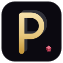
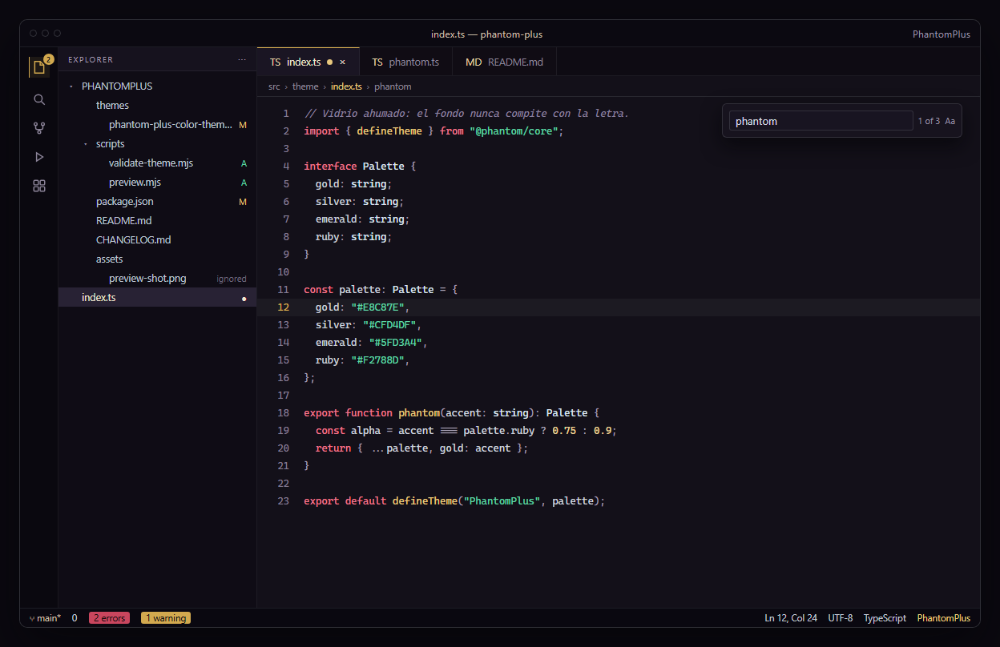

# PhantomPlus



Tema de color oscuro para Visual Studio Code: vidrio ahumado, tipografía en
dorado y plata, y estados en esmeralda y rubí. Pensado para sesiones largas en
estudio o taller, donde el fondo no debe competir con la letra.



> La captura es una maqueta generada desde los valores reales del tema
> (`scripts/preview.mjs`), no un screenshot de VS Code. El bloque de código es
> un ejemplo de sintaxis, no un archivo del repo.

## Dirección

**Atelier nocturno.** Un solo metal manda: el dorado. La plata sostiene la
estructura y los identificadores; la esmeralda y el rubí aparecen solo cuando
significan algo (éxito/agregado, error/borrado). Nada de arcoíris decorativo.

| Rol | Color | Dónde se usa |
|---|---|---|
| Tinta | `#0B0910` | Fondo base de ventana |
| Vidrio | `#14111AE0` | Editor, paneles y widgets con alfa |
| Plata | `#CFD4DF` | Texto de código, variables, bordes finos |
| Platino | `#DDE4F0` | Tipos, clases, interfaces |
| Dorado | `#E8C87E` | Funciones, números, foco y acento de marca |
| Esmeralda | `#5FD3A4` | Strings, diff agregado, éxito |
| Rubí | `#F2788D` | Keywords, errores, diff borrado |

Los estados de Git siguen la misma gramática: agregado esmeralda, modificado
dorado, borrado rubí.

## Qué cubre

- Workbench completo: barra de actividad, lateral, pestañas, panel, terminal,
  status bar, menús, quick input, widgets del editor, notificaciones, settings,
  welcome, notebook, minimap y sticky scroll.
- Sintaxis TextMate para lenguajes comunes (TS/JS, Python, Go, Rust, CSS,
  HTML/JSX, JSON, YAML, Markdown y diffs).
- Tokens semánticos activados por defecto (`editor.semanticHighlighting`).
- Paleta ANSI de terminal y colores de debug/testing/charts derivados de las
  mismas piedras.

## Traslucidez (y su límite real)

Las superficies usan `#RRGGBBAA`. VS Code compone ese alfa sobre
`window.background`: el resultado se ve como vidrio ahumado y conserva el
contraste del texto (el validador lo mide sobre la superficie compuesta).

Ver el **escritorio** a través de la ventana no lo hace el tema: requiere un
compositor externo (GlassIt en Windows, Vibrancy en macOS) y, en general,
`"window.titleBarStyle": "custom"`. Sin eso, el alfa se ve dentro del editor,
no detrás de la ventana.

## Opacidad real de ventana (Windows)

Además del alfa interno del tema, PhantomPlus puede aplicar transparencia real
al proceso de VS Code con `src/glassit/SetTransparency.cs` (WS_EX_LAYERED +
`SetLayeredWindowAttributes`), la misma implementación de GlassIt-VSC que usa
**Russian Hacker Theme**. Se compila al vuelo con `Add-Type`, sin binarios.

- `phantomplus.alpha` (1–255, por defecto **240**) — 255 deja la ventana
  opaca; por debajo de ~200 el contraste cae sobre fondos claros.
- `phantomplus.step` (por defecto 5) — incremento de los comandos.
- Comandos: **PhantomPlus: Aumentar/Disminuir transparencia** y **Ventana
  opaca (255)**. Atajos: `Ctrl+Alt+Shift+Z` y `Ctrl+Alt+Shift+C`.
- Solo actúa mientras el tema activo es PhantomPlus; al cambiar de tema la
  ventana vuelve a 255. El alfa se reaplica al ajustar la configuración o
  recargar la ventana.
- Igual que en Russian Hacker, el alfa se aplica a **todas** las ventanas del
  mismo proceso de VS Code, no solo a la actual.
- Windows solamente; en macOS/Linux los comandos avisan que no está soportado.

La transparencia de ventana y el alfa de las superficies del tema se
multiplican: si el escritorio es claro, conviene subir `phantomplus.alpha`.

Ajustes sugeridos:

```json
{
  "workbench.colorTheme": "PhantomPlus",
  "editor.semanticHighlighting.enabled": true,
  "window.titleBarStyle": "custom",
  "phantomplus.alpha": 240
}
```

## Instalar

Desde VSIX:

```powershell
code --install-extension phantom-plus-0.2.0.vsix
```

En desarrollo: abrir la carpeta en VS Code y presionar `F5`
(configuración en `.vscode/launch.json`), luego elegir **PhantomPlus** con
`Preferences: Color Theme`.

## Verificar

```powershell
node scripts/validate-theme.mjs   # colores, claves criticas y contraste >= 4.5:1
node scripts/preview.mjs          # regenera assets/preview.html
node scripts/render-icon.mjs      # regenera icons/icon.png y icon@2x.png
node --check src/extension.js     # sintaxis de la extension de opacidad
```

El validador compone el alfa antes de medir, así que un `#RRGGBBAA` no puede
esconder un texto que no se lee. Falla con código 1 si algún par baja de 4.5:1.

## Ícono

`assets/icon.svg` es el maestro: monograma P en oro, eco fantasma plateado y
un rubí, sobre la misma tinta del tema. Se exporta a `icons/icon.png` (128) y
`icons/icon@2x.png` (256). Los conceptos descartados quedan en
`assets/concepts/` para trazabilidad.

## Estado

`0.2.0`: tema completo, ícono de marketplace y opacidad real de ventana en
Windows. Pendiente de verificación visual de todos los estados interactivos
dentro de VS Code real y de probar la opacidad en macOS/Linux (hoy no-op).
